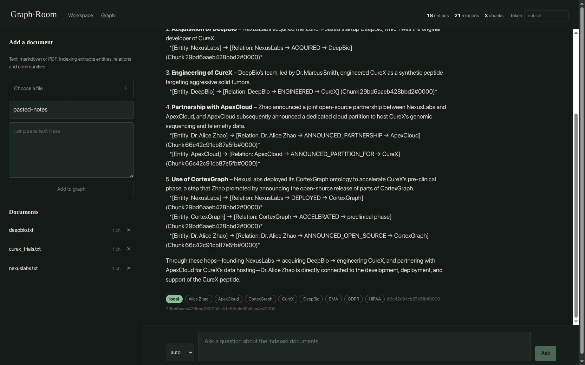
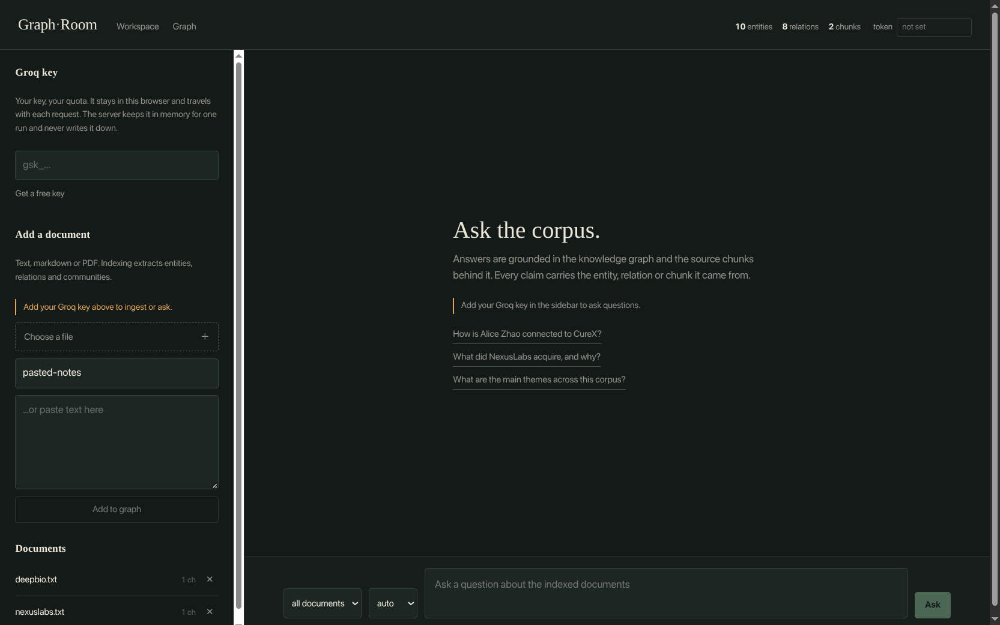
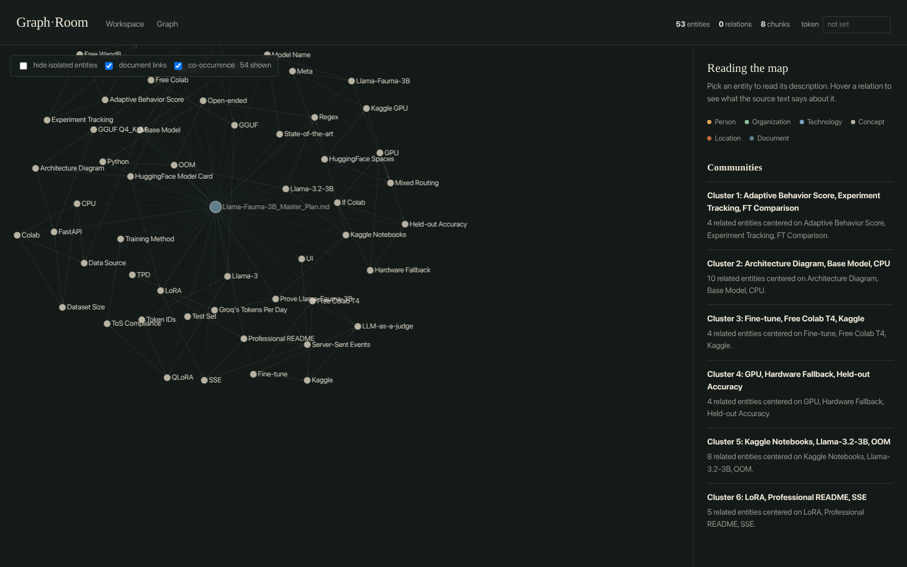

# Graph Room

[](https://github.com/Agent2509/graph-room/actions/workflows/ci.yml)

A knowledge-graph RAG system in a single SQLite file. Drop in documents, the pipeline
extracts entities and relations with an LLM, clusters them with Louvain, and answers
questions either from a bounded subgraph (local) or from community reports (global).
Answers stream token by token and cite the entity, relation or chunk they came from.

**Stack:** Python 3.12 · FastAPI · SQLite (FTS5 + sqlite-vec) · NetworkX · Groq · FastEmbed · Next.js (static export)



| Workspace | Knowledge graph |
|---|---|
|  |  |

```
browser ──► Next.js static files / SSE ──► FastAPI ──► one SQLite file
                                                       ├ documents + chunks
                                                       ├ FTS5          (BM25)
                                                       ├ sqlite-vec    (dense KNN)
                                                       ├ entities/edges/mentions
                                                       └ jobs + caches
                                        Groq ──────────┘ (extraction, answers)
```

## Measured, not guessed

Benchmarked on this machine before choosing storage (100k chunks, 384-dim):

| | |
|---|---|
| Dense KNN via sqlite-vec | **41 ms** per query |
| Sparse BM25 via FTS5 | **0 ms** typical, 38 ms when the query matches nearly every chunk |
| Same vectors in numpy BLAS | 4.7 ms, but 154 MB resident and needs its own sync |
| SQLite file size for 100k chunks | 162 MB |
| Delete a document (chunks + vectors + graph, one transaction) | 0.26 s for 2k rows |
| Test suite | 72 tests, **< 2 s**, no API key |
| Retrieval evals (10 golden questions, replayed LLM) | **mode 1.00 · entity recall 1.00 · chunk recall 1.00** |

Why one file instead of a vector database: LanceDB's own docs say brute force is fine
below ~100k vectors, and a second store means a document delete touching two databases
with no transaction between them. The plan said LanceDB; the measurements said
otherwise. The swap point is one module (`retrieval/vectors.py`).

**Why not LightRAG or Neo4j?** Existing frameworks either need a separate graph server or
spread state across several storage files. This one is an exercise in radical simplicity:
documents, FTS5 BM25, sqlite-vec embeddings and recursive-CTE graph walks in one ACID
file, so deleting a document and recomputing its mentions is a single transaction.

## Quickstart

```bash
# 1. API (port 8000)
uv venv .venv && uv pip install --python .venv/bin/python -e backend
set -a; cp .env.example .env; set +a            # add GROQ_API_KEY, or leave it empty for mock mode
cd backend && ../.venv/bin/uvicorn graph_rag.api.main:app --reload

# 2. Frontend, in a second shell (port 3000)
cd frontend && npm install
NEXT_PUBLIC_API_BASE=http://localhost:8000 npm run dev
```

On first run the app seeds a browsable demo index from the bundled corpus by
replaying recorded LLM responses — zero API calls, so the graph is there before
anyone types a key.

The first thing the workspace asks for is **your** Groq key. It lives in browser storage,
is sent as `X-LLM-Key` with each request, and is cached in server memory for that process
only — never written to disk, never shared between visitors. A server-side
`GROQ_API_KEY` is not used by the API at all, so cloning this repo never spends someone
else's quota.

### One origin (no Docker)

```bash
cd frontend && npm run build
cd ../backend && STATIC_DIR=../frontend/out ../.venv/bin/uvicorn graph_rag.api.main:app --port 8000
# or: make serve
```

FastAPI serves the exported frontend, so there is no CORS and no Node runtime:
`http://localhost:8000` is the whole app. `data/app.db` is the whole state; back it up
by copying the file.

## API

| Route | Purpose |
|---|---|
| `GET /api/health` | status, provider, vector backend (no token required) |
| `POST /api/documents` | file (`multipart`) or `text`+`filename` form; `X-LLM-Key` only in `llm` extraction mode; returns `{document_id, chunks, job_id}` |
| `GET /api/documents` | documents with chunk counts |
| `DELETE /api/documents/{id}` | removes chunks, vectors, mentions; recomputes entities; refreshes communities |
| `GET /api/jobs/{id}` | `queued → running → done/failed`, with phase and progress |
| `POST /api/query` | `{question, mode, document_id?}` → JSON answer + citations |
| `POST /api/query?stream=true` | SSE: `event: meta`, `event: delta` …, `event: done` |
| `GET /api/graph` | nodes + edges for the canvas (`community`, `min_degree`, `limit`) |
| `GET /api/stats` | counts, density, top entities, community reports |

Every route except `/api/health` needs `X-LLM-Key: gsk_...` (the visitor's key).
Set `API_TOKEN` to also require `Authorization: Bearer <token>`.

## How it works

**Ingest.** Text is chunked on paragraph → sentence → word boundaries with overlap.
Document ids are content hashes, so re-uploading the same file is a no-op and chunk ids
(`doc#0001`) cannot collide across documents.

**Extraction modes.** `EXTRACTION_MODE=fast` (default) builds the graph with rules
plus embedding-scored verb phrases: no key, no network, ~0.5 s per corpus. `llm` uses
`EXTRACTION_MODEL` (default `openai/gpt-oss-20b`) when you want richer descriptions.

Measured on the bundled corpus (`backend/evals/compare_extractors.py`):

| | llm | fast |
|---|---|---|
| entities | 26 | 16 |
| relations | 25 | 10 |
| golden retrieval (10 questions) | 1.00 / 1.00 / 1.00 | 1.00 / 1.00 / 1.00 |

The LLM finds more concepts (`computational immunology`, `solid tumors`); the fast
extractor finds fewer, and the ones it emits are correct. Retrieval scores are equal
because chunk retrieval is unchanged.

**Models.** Answers use `GROQ_MODEL` (default `openai/gpt-oss-120b`). Groq limits
apply per model, so the good model keeps its budget for questions.

**Extract.** Chunks go to the LLM in batches of 3. Every item is validated on its own
(`pydantic`): a relationship with `weight: "1.0 (high)"` is coerced, not a reason to lose
the batch. Responses are cached by `sha256(model + chunk texts)`, so a failed job resumes
where it stopped and switching models re-extracts instead of reusing stale triples.

**Store.** Entities and edges keep the aggregate that reads need (description, total
weight), but the truth is the per-chunk mention rows. Re-indexing is idempotent, and
deleting a document is exactly reversible: drop its mentions, recompute the aggregates
from what is left, drop what has no mentions.

**Retrieve.** Local search seeds entities from vector KNN plus exact name matches, walks
a bounded neighbourhood with a recursive CTE over an `adjacency` view, and fuses
mention/BM25/vector chunk rankings with reciprocal rank fusion. If nothing is
retrieved, the LLM is skipped and the API returns "No evidence in the corpus" —
no tokens, no invented answer. Global search ranks
community summaries and synthesizes across them. `auto` routes with keyword hints, then
one LLM classification as a fallback.

**Summarize.** Louvain communities are re-detected on every index run, but a summary is
reused when the member set hash is unchanged. Slow work (LLM, embeddings) always happens
before the write transaction opens — an embed under `BEGIN IMMEDIATE` once froze every
other writer.

## Tests and evals

```bash
cd backend && ../.venv/bin/python -m pytest -q     # 72 tests, offline
../.venv/bin/python backend/evals/run.py                      # graph retrieval
../.venv/bin/python backend/evals/run.py --retriever chunks   # chunks-only baseline
```

**Does the graph actually help retrieval?**

| retriever | entity recall | chunk recall | evidence recall |
|---|---|---|---|
| graph (entity seeds → subgraph → mentions + BM25 + dense) | 1.00 | 1.00 | 1.00 |
| chunks only (BM25 + dense) | – | 1.00 | 1.00 |

On ten questions over the sample corpus, graph traversal does **not** retrieve better than
plain hybrid chunk search. What the graph adds is inspectable evidence — entity ids,
relation labels, community reports — and a natural unit for document deletion. The honest
position is that the baseline is the number to beat: when a larger corpus makes questions
relational, this table is how you would find out.

Tests use a hash-based fake embedder, so they need no model download and no key. The
evals are different: they run the **real** pipeline (real chunker, extraction, graph,
embeddings) against an LLM response recording in `fixtures/llm_responses.json`. That
recording is what makes quality measurable in CI with zero API calls.

Evals score retrieval — which entities, chunks and mode came back — not the prose, so the
score is deterministic. `pytest` fails if the recording no longer matches the current
prompts (`tests/test_evals.py`).

To re-record after changing the extraction prompt or the sample corpus:

```bash
set -a; . ./.env; set +a
python backend/evals/record.py
```

## Layout

```
backend/graph_rag/
  api/          FastAPI app, auth, routes
  pipeline/     chunker, extractor, resolver, graph, communities, vectors
  retrieval/    bm25, fusion, local, global, router, service
  jobs/         asyncio runner with SQLite state
  db.py         schema, WAL, migrations-by-creation
backend/tests/  12 files, 72 tests
backend/evals/  golden questions, recorder, runner
frontend/       Next.js app: workspace + graph
fixtures/       recorded LLM responses, frozen chunker output
```

## Deliberate limits

Each is marked with a `shortcut:` comment in the code.

- **Brute-force vectors.** ~40 ms at 100k chunks, ~400 ms at 1M (1.6 GB). Swap
  `retrieval/vectors.py` for LanceDB/HNSW past ~1M chunks.
- **One indexing job at a time.** SQLite has a single writer; the runner holds a
  semaphore. Move to a worker queue when one job is not enough.
- **Graph traversal in SQL, community detection in memory.** NetworkX loads entities and
  edges for Louvain. Fine to ~1M edges.
- **No cross-encoder reranker.** BM25 + dense + RRF, because the v1 reranker failed
  silently and the evals show no recall gap. The eval report is the trigger to add it.
- **No hierarchical parent-child chunking.** Not in the eval delta; one chunker.
- **The caller's key is held in process memory** (hashed, max 8 clients). Fine for a
  single instance; a multi-tenant deployment wants per-user keys in a secret store.
- **Free-tier Groq limits** cap indexing speed. Batching and retries with the server's
  `retry-after` hint make it visible instead of a hang.

## Not verified here

The frontend was built (`next build`, static export) and exercised manually in Chrome,
but not covered by an automated browser test. Live Groq streaming was exercised once
manually; CI uses the recorded responses.
